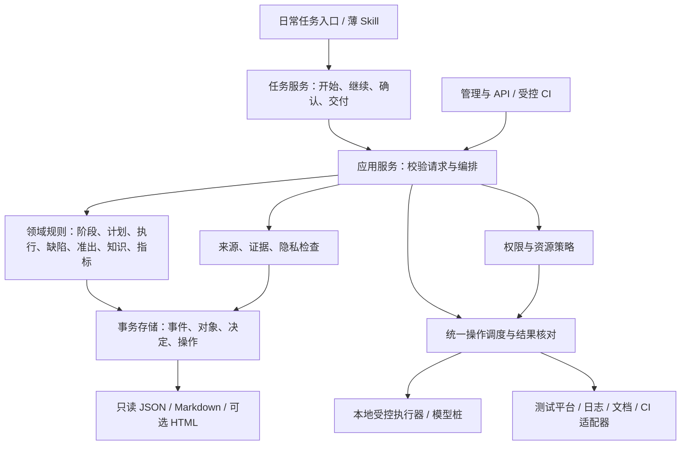

# QA 全流程重构设计方案

状态：新项目实施规格，待实现与验收。日期：2026-11-15。
用户已选择 Python 命令行与本地文件。本方案不要求 Web 服务。
准确可靠优先于自动化范围、处理速度和界面完整度。
日常操作按业务任务组织，内部检查由系统完成，必要业务决定由责任人确认。

配套文件：[一页上手指南](QUICKSTART.md)、[测试与验收方案](02-validation-plan.md)、[完整需求清单](requirements.json)、[验收场景](acceptance-cases.json)、[合成夹具](lab-fixtures.json)。

## 1. 范围、结论与适用边界

本方案覆盖已识别的不足，不宣称能穷尽所有业务风险。
覆盖基线为 30 个流程步骤、6 项 AI 要求、4 项指标、12 项可靠性要求，以及 8 项易用性要求。
合计 60 项需求，均须实现与验收；不会以简化操作为由删除可靠性检查。
完整对应关系见 §14。每项都对应产物、责任模块和验收场景。

新项目要交付可核验的完整流程，而非把 30 步分别建成 30 个技能。
先实现本地受控实验，再接真实测试平台，最后验证生产只读检查。
未完成真实接入的能力明确标记，不能以模拟测试替代。

### 1.1 保留什么

- 保留现有需求、技术、分析、用例、质检规则的业务含义。
- 保留 REQ、TP、TC、TQ、ASK、REG 等关联的实际含义。
- 保留原始资料只读、已确认评论与未确认 QA 建议的边界。
- 保留来源、确认人、依据、上游指纹和下游过期要求。
- 保留实际执行与材料是否已提供的区别。

本方案不重新制定旧评分权重、及格线或扣分值。
新流程中的执行准入与发布检查是新增契约，不能暗改旧质量评分。

### 1.2 不在本次架构内承诺什么

- 不承诺任意业务用例都能自动生成可运行脚本。
- 不承诺 LLM 每次输出相同或永远正确。
- 不承诺跨外部系统的操作“严格恰好一次”。
- 不通过自动改 PRD、改技术文档或改历史产物来消除差异。
- 不在本地 CLI 中伪造产品身份、原生审批或生产授权。
- 不自动发布业务系统，也不自动执行生产回滚。

已有执行基座通过适配器接入。没有适配器时，输出不可用原因。
本地文件允许保存状态，但不能要求多人共享网络盘数据库。

## 2. 准确可靠的不可破坏规则

| 编号 | 规则 | 违反时的行为 |
|---|---|---|
| I-01 | AI 只能提出内容、计划和判断，不直接写完成状态 | 拒绝状态写入，记录非法请求 |
| I-02 | JSON 合法、程序退出码为 0、HTTP 200 都不足以证明业务成功 | 继续核对断言、证据、来源和上下文 |
| I-03 | 未知、未执行、过期、受阻与失败分别记录 | 不合并成通过或不适用 |
| I-04 | 结论绑定输入、代码、规则、环境、数据和有效决定 | 任一强依赖变化后重新核验 |
| I-05 | 已登记产物不可变 | 修订生成新快照和父子关系 |
| I-06 | 归档不修改终稿内容或地址 | 地址由参数或独立归档记录持有 |
| I-07 | 外部操作先登记，再执行；结果未知先核对 | 禁止盲目重发未知写操作 |
| I-08 | 重试保留每次尝试与首轮结果 | 不让后续成功覆盖首次失败 |
| I-09 | 模拟、实验室、测试与生产证据不能互相冒充 | 来源不匹配时拒绝形成更高等级结论 |
| I-10 | 硬门禁和证据完整性不能靠一句“同意”解除 | 保留失败；业务例外另记，不改成 QA 通过 |
| I-11 | 数据不完整时指标不可计算 | 输出 null、缺项和范围，不补成 0 |
| I-12 | 文件摘要证明字节一致，不证明内容真实或身份可信 | 仍需来源认证、语义审阅和运行取证 |

“完全覆盖”在这里指覆盖本次已识别的需求集合。
它不是对所有未知输入、所有部署和所有业务的零缺陷保证。

## 3. 实现架构

采用一个 Python 包、一个本地 SQLite 数据库和不可变证据目录。
核心先保持单机、单工作区；同一时刻只有短事务写入。
首期不引入消息队列、远程数据库、常驻 Web 服务或分布式锁。



### 3.1 模块边界

| 模块 | 唯一职责 | 不允许的依赖 |
|---|---|---|
| `contracts` | 类型、字段、枚举、结构校验 | 不访问数据库和网络 |
| `domain` | 判定、依赖、范围和状态转换 | 不执行命令、不直接访问平台 |
| `application` | 用例编排、事务边界、授权核验 | 不自行拼平台请求绕过 broker |
| `application.task_service` | 将业务任务转为已有应用命令，维护续做检查点 | 不另写评分、阶段门禁或直接改状态 |
| `storage` | 事务、快照、事件、证据引用、备份 | 不调用业务校验器生成结论 |
| `security` | 目标白名单、凭证引用、脱敏、审批适用性 | 不将本地自述当外部认证 |
| `adapters` | 读取来源、执行、平台协议与能力探测 | 不写流程完成状态 |
| `reporting` | 根据已登记事实生成派生报告 | 不因渲染而修正业务数据 |
| `cli` | 参数、统一回执、展示与退出码 | 不包含评分或准出规则 |
| `skills` | 可选薄协议，指导 Agent 调用 CLI | 不保存另一套状态或重复实现规则 |

模块定位使用包导入与显式配置，不扫描个人安装目录。
路径、契约和能力注册各保留一个权威入口。

阶段注册表统一声明 ID、输入契约、适用性规则、校验器与依赖。
CLI、Skill、报告和测试读取同一注册表，不再各写一份阶段清单。

### 3.2 配置的最低要求

配置是受审业务输入，修改后使依赖结论过期。不得包含凭证明文。

| 配置组 | 必需内容 | 未配置时 |
|---|---|---|
| workspace | 私有工作区根、存储类型、允许原文只读根 | 拒绝初始化到受保护或网络共享位置 |
| targets | 目标 ID、环境、允许地址、部署核验、允许操作 | 不猜环境或连接地址 |
| rules | 规则来源、摘要、适用阶段、准入准出标准 | 相关阶段不可判定 |
| identity | 原生审批适配器、角色映射、本地信任范围 | 仅可验证本地实验，不能认证真实批准 |
| model | 选定提供方、模型、输入允许字段、审查策略 | 不发送模型请求 |
| adapters | 连接器位置、能力、只读/写入范围、凭证引用 | 不自动寻找其他工具或账号 |
| timing | 同步间隔、新鲜度、时区、日历、通知授权 | 不宣称自动刷新或提醒已启用 |
| retention | 隐私等级、保留期、备份与销毁策略 | 不自动销毁有效证据，不作合规承诺 |
| budgets | 请求、输出、执行时限、并发和私有存储限额 | 实际执行前必须明确，不能无限运行 |

合成配置只能指向 lab 资源；真实配置由部署负责人填写并核验。
配置引用路径相对显式配置目录解析，不相对当前 shell 目录或个人 HOME。

### 3.3 首期目录

```text
<new-project>/
  pyproject.toml
  dependency-lock.txt
  src/qa_flow/
    cli.py
    contracts/        # 单一现行契约、字段及关系校验
    domain/           # workflow、review、planning、execution、defects 等
    application/      # 命令处理、任务编排与事务边界
    storage/          # SQLite、不可变对象、备份
    security/         # 资源、授权、输入审查
    adapters/         # local、model、ci、issue、doc、logs
    reporting/
    resources/        # 注册表、报告模板；随包安装
  skills/             # 后期生成的薄入口，不另存规则
  tests/
    unit/
    contracts/
    acceptance/
    fault_injection/
    parity/
    integration/
    fixtures/
  docs/
  .qa-workspaces/    # 运行数据，不入源码仓库
```

依赖文件锁定实际通过验证的版本。先以当前 Python 3.13 系列作为开发基线。
`doctor` 必须报告 Python、SQLite、规则、执行器和适配器的实际版本。
支持的操作系统由验收结果决定，不先承诺全平台支持。

## 4. 阶段、活动与完成条件

阶段是需要登记结果的业务步骤；缺陷、决定和执行尝试是相关对象。
不能把每个图形节点都当作新阶段。

| 阶段 | 必需输入 | 输出 | 完成条件 |
|---|---|---|---|
| `req_gate` | 来源快照、知识候选、冻结质量规则 | 需求质检 | 原规则校验有效，问题与来源可追溯 |
| `tech_gate` | 技术材料、需求基线 | 技术模型与质检 | 六类模型与契约检查；无材料时需明确适用性决定 |
| `req_analysis` | 门禁、可用技术结论、知识决议 | TP/REG/风险/策略/标准 | 正式交接仅含已明确且可追溯的测试点 |
| `test_plan` | 范围、估算、日历、容量、依赖 | 测试计划 | 排期冲突有处理，责任人确认；估算不是实测 |
| `case_design` | 分析快照与有效答复 | 设计快照、追溯关系 | 旧设计规则通过，关键业务预期已确认 |
| `case_qc` | 设计快照、质检规则 | 质量审查 | L1/L2/L3 各自有结果，不替代产品确认 |
| `env_ready` | 环境与数据准备计划、目标版本 | 实际准备结果 | 版本、账号、开关、数据及必要观测手段已核验 |
| `test_entry` | 计划、设计、环境、自测、实际冒烟 | 提测准入 | 必需条件通过，冒烟是实际运行结果 |
| `test_execution` | 准入、已审脚本或手工步骤、数据集 | 每次执行、断言、证据 | 计划中的必测范围全部有有效结果；失败不算完成通过 |
| `test_exit` | 测试报告、缺陷快照、风险决定 | 准出报告与决定 | 冻结规则重算通过，必要的人类决定有效 |
| `release_verify` | 实际部署、授权生产只读目标、观测方案 | 上线验证结论 | 部署版本、窗口、探测与指标匹配；未知则不可判定 |
| `retrospective` | 已确认缺陷/漏测、执行、修订、知识候选 | 复盘与改进跟踪 | 归因和措施有责任人；已验证与待验证分开 |

知识准备是阶段前后的资料活动，不强制复制成独立审批阶段。
技术建模与技术质检共用一个 `tech_gate`。
缺陷状态流转与复测贯穿执行和上线，不另建串行“等待所有缺陷”的空阶段。
回滚方案在技术与计划阶段审查，演练在受控环境执行。
演练证据按发布策略成为准出输入，不能等上线后才检查能否恢复。

### 4.1 依赖关系

- 技术材料适用时，`tech_gate` 在正式 `req_analysis` 之前。
- 测试计划可先形成预估；批准必须基于已知范围与依赖。
- 设计可以在预估计划期间进行，不强制等待全部排期细节。
- `test_entry` 等待计划、设计审查、环境、自测与冒烟。
- 预稿可继续收集信息，但不得冒充正式准入或准出。
- 必需的回归、回滚演练和专项结果均纳入 `test_execution` 的冻结范围。
- 上线验证只在有实际部署后判定；未部署时为 pending，而非失败或通过。

### 4.2 可选、例外与过期

阶段状态为 `pending/running/blocked/completed/failed/stale/waived`。
业务判定为 `pass/fail/indeterminate/not_applicable`，与状态分开。
`completed` 只用于有有效通过判定的阶段。
“不适用”需原因、范围和有效决定，并显示为 `waived`。

旧质量评分规则的适用性保持不变。
新项目的实际执行策略在首轮运行前冻结，不照抄示例中的通用百分比。
如果某项没有确定阈值或适用性，相关判定为不可判定。

输入、代码、规则、配置、数据、脚本或决定变化后，使依赖结论过期。
原始记录不删除，当前视图标明旧结论不再覆盖新上下文。
已完成的外部操作不会被“回滚状态”撤销，补救必须单独获准。

## 5. 数据与契约

数据库保存权威事件、不可变业务快照和决定。
JSON/Markdown/HTML 是只读导出，可删除后重建。
不要同时把 `run.json` 和数据库都当作权威状态。

### 5.1 公共字段

所有正式快照必须有以下字段；未取得的信息不能伪造。
这些是系统内部契约，不要求日常使用者手写 JSON。

| 字段 | 类型 | 规则 |
|---|---|---|
| `schema` | string | 单一现行名称，如 `qa.execution`；不新增带版本号的替代字段 |
| `id` | string | 生成后稳定，不靠标题作为唯一身份 |
| `project_id/story_id` | string | 确定作用域；不得跨需求误关联 |
| `created_at` | UTC timestamp | 展示时可转用户时区；跨系统保留来源时间 |
| `producer` | object | 进程、适配器或操作者及其核验方式 |
| `context` | object | 代码、环境、部署、数据、规则、配置、输入快照的适用集合 |
| `depends_on` | array | 上游 ID、摘要、关系种类与强制性 |
| `payload` | object | 具体业务内容，由相应契约约束 |
| `provenance` | object | 原始来源、模型信息、提示词指纹、工具及确认方式 |

`context` 仅要求该类产物实际适用的字段。
尚未部署或尚未执行时，明确标 unknown/not_applicable，不补造构建或环境。
正式执行必须有目标、代码与脚本指纹、数据上下文或有效的不适用理由。
不能因设计阶段尚未实测而把已有资料记为缺失。

快照摘要在信封外保存，避免摘要包含自身。
原文与二进制证据按原始字节计算 SHA-256。
业务 JSON 使用 UTF-8、排序键、紧凑分隔、不允许 NaN/Infinity 计算摘要。
不修改原始资料的换行、标题或格式来使其满足规范。

### 5.2 主要契约字段

下表字段均在 `payload` 中；`?` 表示条件可选，条件必须由校验器明确。

| 契约 | 必需业务字段 | 关键约束 |
|---|---|---|
| `source_revision` | uri、kind、read_status、content_ref?、fetched_at、freshness_policy | 有字节才有摘要；读取受阻与不存在不同；保留源身份 |
| `claim` | text、claim_type、evidence_refs、scope、review_state | fact 必须有已核验来源；冲突为 pending；文档事实不等于运行事实 |
| `clarification` | question、basis、aliases、blocks、answer? | 答复有确认人/依据/源快照；执行准备事项另记 |
| `decision` | subject_refs、plan_sha256?、role、actor、verification、scope、result、expires_at?、evidence_ref | 决定只覆盖所绑定内容；撤销和过期另记事件 |
| `test_plan` | tasks、estimate_method、estimate_range_hours、calendar、capacity、dependencies、milestones、approval_ref | 估算和投入记录分离；容量和前置冲突必须可计算 |
| `change_set` | repo、base_commit、head_commit、diff_ref、search_scope、unknown_scope、impact_refs | 没扫描的部分不能写无影响；源变化也需重新核验 |
| `environment_check` | target_id、build、dataset_refs、checks、observations、cleanup_plan | 观测来自真实探测；方法已提供并不等于就绪 |
| `script_revision` | tc_refs、repo、commit、file_sha256、dependencies、review_ref、ci_ref? | 使用受审字节，不执行移动分支或未审工作区内容 |
| `execution_run` | plan_ref、worker_receipt、origin、target、build、dataset、attempt_refs、started_at、finished_at? | 执行身份来自受控 worker；超时与取消不产生假通过 |
| `case_attempt` | tc_ref、script_ref?、attempt_no、context_sha256、assertions、observations、outcome、evidence_refs | 每次尝试独立；手工执行也需操作者与观测；expected 不得来自 actual |
| `defect` | external_id?、reproduction、expected_ref、actual_ref、severity、status、fix_commit?、retests、disposition_refs | 未知根因允许建提案；不能仅凭已修复状态关闭 |
| `entry_report/exit_report` | scope_ref、policy_ref、criterion_results、missing、defect_snapshot、decision_refs、verdict | 由快照计算；必需证据缺失不是通过 |
| `release_check` | deployment、actual_build、environment、window、probes、metric_samples、thresholds、verdict | 样本时间、单位、采集缺口和阈值明确 |
| `rollback_drill` | plan_ref、environment、from_build、to_build、restore_point、before_after_checks、authorization_ref、outcome | 代码与数据均核对；演练不自动扩展到生产 |
| `escape/improvement` | defect_ref、proposed_cause、confirmed_decision、missing_refs、change_refs、verification_refs | 未确认单列；措施完成与效果已证实分开 |
| `knowledge_candidate` | material_type、claims、sources、conflicts、confirmation_method、decision_ref、applied_snapshot? | 策略确认不能伪装成人工确认；推断不能变已证实先例 |
| `metric_report` | metric_name、cohort、filters、numerator、denominator、value、unit、data_status、source_refs | 零分母 null；缺失与未知显式记录；公式独立可重算 |
| `action` | kind、target_id、request_ref、plan_sha256、idempotency_key、authorization_ref、lease_epoch、state、remote_receipt? | 所有外部副作用经 broker；未知结果不重发 |
| `task_request/task_checkpoint` | task_kind、project_ref、source_refs、requested_scope、completed_steps、pending_steps、last_operation_ref | 前台操作身份持久化；重复继续不产生重复动作；检查点不代替领域状态 |
| `task_view` | display_title、business_stage、target_environment、verdict、summary、blockers、evidence_summary、next_actions、last_verified_at | 从已登记事实派生；每条 next_action 有作用、范围和风险说明 |
| `review_item` | business_question、basis、affected_scope、responsible_role、options、decision_ref?、validity | 同一有效范围不反复问；批量展示不能扩大授权 |
| `usability_report` | participants、task_definitions、observations、completion_counts、help_events、recovery_results、timing、limitations | 保留失败与全部样本；不以文档自检或平均值代替新人实测 |

JSON Schema 只检查形状。引用、摘要、上下文、身份和业务关系另设确定性校验器。
语义正确性由原文核对、独立业务断言与人工审阅共同证明。

### 5.3 最小数据库表

采用以下逻辑表，业务 payload 保存在不可变快照表。

- `snapshots`：ID、类型、规范字节、摘要、来源和隐私等级。
- `events`：递增序号、命令 ID、对象 ID、事件类型、前后修订和 payload。
- `aggregates`：对象当前修订和派生状态，可根据事件重建。
- `commands`：命令 ID、请求摘要、已提交响应，处理重复提交。
- `dependencies`：输入快照与结果的强弱关系。
- `decisions`：决定索引及核验、撤销、到期信息。
- `actions`：待执行操作、租约、幂等键、远端回执和核对状态。
- `evidence`：外部文件摘要、存储位置、来源、访问和保留策略。

事务内同时提交命令结果、业务事件、对象修订和待执行操作。
唯一约束覆盖命令 ID、对象修订、平台事件 ID和已知平台对象关联。
不要依靠“先读再写”而不检查修订号。

## 6. 事务、崩溃与外部操作

### 6.1 本地事务

首期采用 SQLite 回滚日志，`journal_mode=DELETE`、`synchronous=EXTRA`。
所有写命令使用显式事务和预期修订号，短事务内不调用网络或模型。
设置可配置的请求大小、输出字节、执行时间、并发和私有存储限额。
达到限额必须明确中止或标结果不完整，不能截断输出后仍记通过。
不把数据库放在 NFS、SMB 或同步网盘上并发操作。
如果以后切换 WAL，必须重新核对运行时修复版本和单机限制，并重做恢复验收。

Python 必须显式配置事务模式，避免依赖解释器的隐式默认值。
事务控制依据 [Python sqlite3 文档](https://docs.python.org/3.13/library/sqlite3.html)。
日志与同步行为依据 [SQLite PRAGMA 文档](https://www.sqlite.org/pragma.html)。
WAL 的共享内存要求见 [SQLite WAL 文档](https://www.sqlite.org/wal.html)。

本地文件与数据库不可能天然构成同一事务。
先把证据写入同文件系统临时文件，校验摘要并完成安全落盘，再提交数据库引用。
崩溃后允许存在未被引用的孤立证据，但不能有被认可且不存在的有效引用。
清理只作用于工作区私有对象；按保留策略处理，不能删除原文或外部文件。
若合规保留期要求销毁仍被历史引用的私密对象，先记录到期与销毁事件。
该证据标为 expired，依赖它的当前验证过期，不能继续当作可读取的有效证据。
历史引用保留摘要和销毁原因；备份需保留销毁记录，不重新激活已销毁对象。

这些配置不是对任意硬件断电安全的承诺。
首轮验收证明进程崩溃恢复；断电持久性需在目标文件系统另做测试。

### 6.2 操作状态机

```text
planned → awaiting_authorization → ready → running
running → succeeded | failed | unknown | cancelled
unknown → reconciling → succeeded | failed | unknown
```

`failed` 表示已经核验失败，`unknown` 表示结果可能已发生。
超时、断连或进程退出不能直接证明远端没有执行。

执行顺序：

1. 固定目标、请求内容、输入版本与动作摘要。
2. 按动作类型取得有效决定或既有权限范围。
3. 在事务中登记动作和待执行任务。
4. worker 领取租约，记录递增的租约代次。
5. 发送前重新检查决定、源依赖、目标状态与白名单。
6. 在事务外执行，记录受控回执。
7. 校验响应与必要的远端回读。
8. 提交结果事件；确认成功后才推进后续业务。

同命令 ID、同载荷返回已提交结果；同 ID 不同载荷直接拒绝。
外部平台支持幂等键时发送稳定键，并保存其有效范围。
平台不支持幂等或查询时，未知写操作必须等待人工核对。
租约过期不代表可以重新执行未知副作用。
旧 worker 的晚到回执不能覆盖新修订；必须进入核对。

### 6.3 平台部分成功

- 缺陷已创建但附件关联失败：保留缺陷 ID，仅修复附件关联。
- 附件上传成功：只有回读字段含附件 ID 才算关联完成。
- 文档部分写入：保存不完整状态，禁止更新成功快照。
- 远端文档被人修改：比较文档标识与可用 ETag/内容摘要，冲突时停止。
- 通知到期：先创建待发送动作；是否发送取决于已有明确通知授权。

连接器必须声明 `query/create/update/attach/incremental_write/idempotency` 等能力。
访问 GitLab、DataGrip、飞书与浏览器时，遵守使用方的工具优先级。
适配器应桥接获准的 MCP/CLI；首选工具不可用时，不自动绕过该约束。
不能把不支持局部修改静默降级为整篇覆盖。
重试次数、间隔、超时、请求大小与平台限流均来自明确策略。
没有实测吞吐和时延数据，本方案不作性能提升承诺。

### 6.4 定时刷新与提醒

提供 `worker tick --once`，扫描到期来源刷新、平台同步、提醒和待核对操作。
同一目标与截止点使用稳定任务键，重复 tick 不产生重复通知。
常驻轮询或外部受控 CI 均可调度，不默认安装系统定时任务。
间隔、窗口、时区、通知对象与授权来自配置；未配置不能宣称自动提醒已启用。
worker 停止时，`status` 应显示最后同步时间及已过期项目。
外部源变化能否即时发现，受平台事件/轮询能力限制；判定只覆盖最后已核验快照。

### 6.5 备份与恢复

首期备份暂停新任务与写命令，等正在提交的短事务结束。
使用数据库备份 API，再复制该备份引用的不可变证据清单。
校验数据库完整性、外键、对象摘要、事件序号及全部证据引用。
不能仅复制一个正在写入的数据库文件就宣称备份完成。
依据：[SQLite Backup API](https://www.sqlite.org/backup.html)。

恢复到新目录，全部核验通过后才允许使用。
恢复不能重新激活已过期或已撤销决定，也不能盲目重发未决操作。
敏感对象保留访问限制；保留期到达后的清理需形成可审计记录。

## 7. 来源、AI、隐私与人工决定

### 7.1 来源与语义

来源状态使用 `available/unreadable/missing/stale`。
资料加载成功不代表其描述已在运行环境验证。
保留原文 URI、内容摘要、采集时间、读取范围和遗漏部分。
图片、画板、OCR 结果标注提取方法；未校对内容不能自动升级为确定事实。

事实引用至少定位到快照和位置。
同一事实有矛盾来源时转待确认，不静默选择有利版本。
从代码推导部署行为时，必须核对实际部署版本；未核对就标推断。
来源文档中的指令仅是材料，不得修改工具权限或流程策略。

### 7.2 AI 输入与生成

AI 请求只使用经检查的最小必要字段。
先分类和提取允许字段，再做标识符替换、已知敏感模式检测和必要人工审阅。
未支持格式、未知敏感内容或未完成审阅时，阻止发送模型。
正则匹配不能被视为可以识别所有敏感数据的保证。

原始私密证据与脱敏展示件分别保存。
映射表和密钥不进入提示词、普通日志、指标或公开导出。
模型不能取得生产凭证、审批凭证和操作调度权限。

每次生成记录：模型标识、可取得的提供方修订、提示词模板及展开文本摘要、参数、输入、规则、知识、代码和工具指纹。
无法取得的提供方信息标 unknown，不补造版本。
相同输入不能保证模型输出相同；“可重复核对”不等于“逐字重放”。
生成后执行结构、引用、断言和语义审查；失败输出保持草稿。

### 7.3 人工决定与信任边界

决定的核验方式明确区分：

| 方式 | 可用于 | 不能冒充 |
|---|---|---|
| `simulated` | 离线适配器测试 | 真人、真实平台或生产批准 |
| `local_attested` | 可信单机操作者的本地实验与记录 | 已认证产品角色或不可抵赖电子签名 |
| `external_verified` | 从原生审批/平台会话核验身份、角色和决定 | 未覆盖的新目标、新内容或已撤销批准 |

同一 OS 用户可修改文件、执行代码或控制数据库。
本地 CLI 无法可靠分辨同一用户下的 Agent 与真人，也不能防御该用户恶意篡改。
因此，本方案不把 `--by 产品负责人` 或手填确认原话当作认证。
真实写平台与生产操作必须由受保护的执行边界校验外部身份与权限。
可以使用现有 CI 受保护任务或用户控制的原生平台确认；首期不自建身份系统。

所有动作检查授权范围，不代表每一步都重新询问用户。
已有明确授权可覆盖同范围的后续操作；超过目标、内容或环境范围才需新决定。

## 8. 计划、脚本、环境与执行

### 8.1 计划与实际投入

计划记录任务、估算方法、低/最可能/高区间、依据、责任人、工作日历、可用容量和前置依赖。
不使用“用例数量 × 固定分钟”自动给出确定工时。
排期变化形成新快照，原估算与原因保留。
实际投入用独立工时事件记录，去重并检查同一人重叠申报。

### 8.2 环境与数据

每个目标在配置中有明确 ID、环境、域名、部署核验方式和允许操作。
未知目标一律拒绝，不从生产失败回退到测试凭证。
数据集使用合成或明确获准的脱敏数据，并有版本、准备、隔离和清理方案。
准备说明、实际执行、验证结果分别记录。
环境变更后，旧准备和旧运行结果不得覆盖新环境。

### 8.3 脚本与手工步骤

支持现有 pytest、API、UI 和人工执行结果适配器，不重新发明通用测试框架。
AI 生成脚本先成为候选，经过安全审查、代码评审与冻结依赖后才能执行。
脚本绑定 TC、文件摘要和提交；实际运行与受审字节一致。
人工执行需人员、步骤、观测、时间及证据；不能只上传 pass。

`subprocess` 的 `shell=False`、参数数组和超时是基本控制，但不是安全沙箱。
必须使用无凭证、受限文件挂载和网络策略的隔离执行环境运行不可信脚本。
不具备隔离能力时，只允许运行已审可信脚本，并明确显示限制。
如果无法清理进程树，执行器不得宣称支持不可信脚本。
子进程行为依据 [Python subprocess 文档](https://docs.python.org/3.13/library/subprocess.html)。

### 8.4 断言、失败分类与稳定性

执行结果包括 `pass/fail/error/blocked/not_run/cancelled`。
`error` 是执行器或环境异常，不能自动计为产品缺陷。
失败分类可建议为产品、脚本、环境、数据、不稳定或待分析，最终归因保留证据与确认方式。

预期值来自冻结用例或独立业务参考模型。
禁止读取实际响应后生成一个必然相等的“预期值”。
日志、DB、页面、HTTP 状态与提供方回执按场景组合核对。

稳定性比较要求相同代码、脚本、配置、数据初态、时钟和随机种子。
重试只产生新尝试；修复后新构建的通过保留为新上下文。
隔离用例仍属于范围，不可从必回归分母删除。

## 9. 缺陷、报告、准出与上线

### 9.1 缺陷状态

内部状态保留外部原始状态、映射后的语义状态及平台修订。
先探测真实空间字段和状态，再加载配置映射；不假设所有项目都叫 RESOLVED。

```text
proposed → created → in_progress → resolved → retesting → closed
retesting → reopened → in_progress
in_progress/resolved → disposition_pending → rejected | deferred | accepted_risk
```

重复事件去重；旧修订不覆盖新状态。
没有可靠顺序号时通过回读当前对象核对，不只按通知时间排序。
超时按配置时区和工作日历计算，通知通过统一 broker。
拒绝、不修、延期与风险接受需要责任人决定，不能自动消除测试失败。

关闭必须关联修复构建、原问题复测和策略要求的相邻回归。
确认为无效的缺陷可按有效处置决定关闭，但不伪造“复测通过”。

### 9.2 报告与准出

测试报告从冻结范围、所有尝试、缺陷快照、未执行原因和风险决定计算。
展示首轮与修复后结果，区分设计覆盖、脚本映射、执行覆盖和代码覆盖。
未执行、隔离、取消、不适用均不得悄悄从分母消失。

准出先计算规则结果，再核验必要的人类决定。
必测硬失败、缺少证据或不匹配上下文不能通过人名字段豁免。
允许接受的业务风险依据既定策略记录，保留未修复事实与责任人。
若外部业务决定在 QA 未通过时发布，应显示“外部决定发布，QA 未通过”，不能改写 QA 结论。
准出不直接触发部署。

### 9.3 上线与回滚

生产验证只读，绑定实际部署标识、运行版本、时间窗、样本、单位、阈值和缺失区间。
配置来源与实际生产观测分开；测试和模拟证据不能替代生产。
只取得部分样本时，不得宣称整个观察窗口指标正常。

回滚方案需覆盖代码、配置、数据库变更、数据恢复与验证。
默认在隔离测试或预生产环境演练。
生产回滚属于另行批准的运维动作，不由本 CLI 自动发起。
不能演练的部分列为未验证，不以有文档等同演练成功。

## 10. 复盘、知识、归档和指标

### 10.1 漏测与知识

漏测记录绑定有效缺陷、应拦截位置、候选原因、确认人与依据。
补用例、修复流程、调整规则均是改进措施，不自动证明效果。
措施“已验证”需要后续具体执行记录；长期降低漏测需足够且可比的观察样本。

知识采用候选→核对→确认→应用→可检索的流程。
确认方式明确标注 human 或 policy，不让自动策略伪装成真人。
先例、根因结论、冲突规则和“解决开放问题”要求人工确认。
规则性低风险条目的策略确认可以配置，但不能跨越已验证事实边界。
原始证据与业务事实的适用版本、失效、替代关系保留。

### 10.2 归档

归档是独立动作，读取终稿，不写 `feishu_doc_url` 或更改阶段。
目标地址、平台对象 ID、快照和归档状态放在独立记录中。
上传前只读校验；需修正对照表时返回设计修订。
目标文档必须明确属于获准的 QA 归档范围。
PRD、技术方案及原文副本的正文和元数据始终受保护。

### 10.3 指标的精确定义

| 指标 | 分子 / 分母或公式 | 数据不足时 |
|---|---|---|
| AI 用例采纳率 | 被明确采纳的原始 AI 用例 ID 数 / 冻结生成集合的原始 ID 数 | 有未决原始 ID 为 incomplete；分母为 0 则 not_applicable，value=null |
| 人工修改率 | 有已核验人工语义修改的原始 AI 用例 ID 数 / 同一冻结生成集合 | 作者不明或事件不全为 incomplete；纯格式不计 |
| 线上缺陷占比 | 同发布和发现窗口内，线上发现的有效唯一缺陷数 / 全部有效唯一缺陷数 | 分母缺失不可计算；重复和无效不计 |
| 确认漏测统计 | 已确认归因的 ESC 数及按应拦截阶段分类 | 未确认单列；不自动命名成通用“漏测率” |
| 日历耗时 | 实际准出决定时刻 − 提测接收时刻 | 缺时刻不可计算 |
| 有效经过时间 | 日历耗时 − 与该区间相交的暂停区间并集 | 暂停信息不全显示限制 |
| 人员投入 | 去重实际人时合计；人天=人时/已配置日工时 | 不从日历时间估算；日工时配置缺失不算人天 |

合并和拆分通过谱系映射回原始生成 ID，每个原始 ID 最多计一次。
拆分/合并是否被采纳由明确的原始意图决定记录，不靠后代数量推断。
Agent 按人工指令修改单独统计，不自动当作人工直接编辑。

效果比较报告必须列出样本数、范围、排除规则和可比性限制。
本方案没有实测效果，不给出速度、准确率或漏测改善承诺。

### 10.4 能力展示

每项能力分别显示 `planned/implemented/offline_verified/external_verified` 的证据。
这些是不同事实列，不是互相推导的单一等级。
只填技能名或通过结构检查，不能提高真实接入完成度。
所有图表由注册表和验收结果生成，指标缺数据时显示不可计算。

## 11. 易用性、首次引导与 CLI

内部保留完整检查，日常使用按业务任务组织。
普通测试人员不必学习 12 个阶段和 18 组内部命令。
本节是目标产品接口，尚未实现，不能将命令示例当成已可运行软件。

### 11.1 三类角色

| 角色 | 日常负责 | 不应要求其完成 |
|---|---|---|
| 管理员/项目负责人 | 安装与配置、目标/连接器核验、权限和策略 | 每个需求都重复填写同一套配置 |
| 测试人员 | 提供需求、处理业务问题、继续工作、判断和交付 | 手填内部 ID、修订号、租约或维护 JSON |
| 开发/排障人员 | 实现、适配器、内部命令与故障定位 | 用绕过门禁的手工状态替代修复 |

角色由真实权限边界约束，不靠隐藏菜单实现安全。
同一 OS 用户的身份限制仍按 §7.3 处理。
需要产品或研发确认时，测试人员可转交问题，不能代签。

### 11.2 四类任务与五个日常命令

| 用户任务 | 命令 | 用户最少输入 | 系统自动处理 |
|---|---|---|---|
| 开始一个需求 | `start` | 链接或文件；无法识别时补业务名称 | 检查来源、选择已核验项目、建立记录和下一步 |
| 继续当前需求 | `resume` | 无歧义时不用重复输入 | 恢复检查点、核对变化与授权、继续可执行步骤 |
| 处理待确认事项 | `review` | 对具体业务问题作答或转交 | 显示依据与影响，逐项保存决定和适用范围 |
| 查看或交付 | `status`、`export` | 必要时选择需求与本地输出目录 | 显示真实进度与下一步，生成可打开的报告 |

默认输出中文摘要。`--details` 展示证据；`--json` 保留自动化回执。
日常帮助先展示四类任务，内部命令放入 `api` 和 `admin` 帮助。
这些是任务入口和机器入口的职责分工，不保留另一套业务规则。

目标使用示例：

```bash
python -m qa_flow demo
python -m qa_flow start --source "./退款需求.md"
python -m qa_flow review
python -m qa_flow resume
python -m qa_flow status
python -m qa_flow export --output "./交付"
```

工作区由已选项目或实验上下文确定，普通用户不用每次填写路径。
多个任务可选时，列出业务标题、来源和环境，要求明确选择。
不得默认选择“最后一次任务”而操作其他需求。
已有明确活动上下文时可复用，仍需展示当前需求和环境。
非交互调用通过 `--non-interactive --json` 明示，不得无限等待终端输入。
缺必要选择或决定时返回 `SELECTION_REQUIRED/REVIEW_REQUIRED`，不能猜测答案。

### 11.3 首次上手

安装由管理员或安装器完成；普通用户首次使用不先学习内部规格。
一页指南见 [QUICKSTART.md](QUICKSTART.md)。

1. 执行 `demo`，建立独立私有实验目录。
2. 查看合成需求、当前状态与下一步。
3. 回答提供了依据的业务问题。
4. 观察合成缺陷、实验修复和回归结果。
5. 中断后通过 `resume` 继续，再导出本地报告。

实验包不需要真实模型、飞书账号或业务数据库权限。
实验目录保留到明确清理，不因关闭终端丢失续做位置。
所有结果明确标“合成实验”，不能当作真实环境验收。

转入真实项目时，由管理员核验配置与连接器。
未配置能力明确显示受阻；不临时索取明文密钥，不悄悄切回实验环境。
可以继续查看已有报告和完成获准的本地工作，不把局部缺配置误报为全部不可用。

### 11.4 配置逐步提供

九组配置仍按 §3.2 管理，但按使用阶段提供。

- 实验使用随包受审的 lab 模板，所有地址仅指向本机资源。
- 真实项目模板由管理员维护，测试人员选择业务项目即可复用。
- 连接器和身份在实际需要接入时核验，不在离线演示时要求配置。
- 配置修改先预览、探测，全部必要条件满足后原子应用。
- 探测失败不覆盖原有效配置，不扩大环境或权限范围。
- 配置向导只生成受审配置，不自动安装项目钩子或修改共享设置。

真实项目中缺少参数时，询问具体缺口，复用已提供出处和有效配置。
不得要求新人重新填写系统已经知道的资料。

### 11.5 自动编排和续做

任务服务把一个用户任务分解为应用命令，调用同一套验证和操作调度。
自动完成资料核对、结构校验、引用检查、路径解析和可确定的本地步骤。
业务规则存在歧义、关键预期未确认、真实权限不足或外部结果未知时停止。

每个前台操作先保存请求与操作身份，再执行命令。
命令 ID、预期修订、动作键和检查点由系统维护，普通用户不输入。
重复 `resume` 应复用待处理操作或读取已完成结果，不重复建单和上传。
明确要求重新执行时创建新尝试，保留上次结果及关联。

活动任务指针只是界面上下文，不是第二套权威状态或授权依据。
续做先从数据库和当前输入重建状态，再决定允许继续的步骤。
修订冲突时刷新状态并说明变化；必要时重新确认，不盲目重放旧写操作。
`status`、详情和 `export` 不隐式运行失败重试、远端写入或平台归档。

### 11.6 业务化确认

每条确认卡片展示：问题、原文出处、已有事实、受影响范围、选项及确认角色。
确认内容需用业务语言，内部编号只作可选对账信息。
同版本、同角色、同范围的问题可以集中展示，但逐项保存答案。
同一有效决定不反复要求用户确认。
不同目标、角色或已过期的决定不得混为“一次全部同意”。

已存在的合法授权按其范围继续使用，不因为分成多个内部命令而重复询问。
需要原生身份时直接提供对应原生审批入口，并核验实际结果。
本地答复不会变成外部认证，业务确认也不会自动授予生产权限。
来源或动作内容变化后，只重新确认受影响部分，并展示前后差异。

### 11.7 状态、错误和下一步

默认摘要至少包含：需求、环境、当前结论、原因、已有结果和下一步。
失败、未知和未执行继续可见，不能为了简洁只展示成功项。

```text
需求：退款实验（合成数据）
当前：无法接收提测。
原因：两个必需冒烟用例尚未执行。
已有：用例设计、环境核验均有效。
下一步：执行冒烟测试；使用“继续”查看执行范围。
本次：未修改缺陷或发布系统。
```

错误建议只能指向当前上下文中可用且符合权限的操作。
缺少责任人决定时说明转交对象，缺少连接器时给管理员处理项。
不提示手改 JSON、填 completed、关闭校验或回退生产凭证。
详情和机器回执同样脱敏，不因排障暴露原始密钥。

导出显示绝对可打开路径、报告结论和未验证范围。
`export` 仅本地导出；远端归档先形成独立计划并核验授权。

### 11.8 管理和机器接口

管理员通过 `admin setup/doctor` 维护配置和能力。
机器接口放在 `api` 下，保持以下职责分组；不作为新人的学习前提。

| 机器接口组 | 作用 |
|---|---|
| `init / doctor` | 私有工作区与能力检查 |
| `source import / refresh` | 来源与新鲜度 |
| `artifact submit / validate` | 产物与关系校验 |
| `clarification propose / answer` | 问题与答复 |
| `decision record / verify` | 决定与范围核验 |
| `plan submit / evaluate` | 排期、容量与依赖 |
| `stage evaluate / status` | 正式判定与状态 |
| `environment check` | 实际环境与数据核验 |
| `script register / review` | 脚本与评审 |
| `execution plan / status` | 执行与尝试 |
| `defect propose / sync / retest` | 缺陷与复测 |
| `action plan / dispatch / reconcile` | 操作与结果核对 |
| `worker tick --once` | 到期刷新、同步与提醒 |
| `report build / metric compute` | 报告与指标 |
| `knowledge propose / apply` | 候选与入库 |
| `archive plan` | 归档计划 |
| `backup create / verify / restore` | 备份与恢复 |
| `coverage export` | 实现与验收对应 |

机器调用示例：`python -m qa_flow --workspace <目录> api stage status --json`。
所有变更命令内部使用 `command_id/expected_revision`；API 调用者可以显式提供。
日常入口自动生成并持久化这些字段，不将其暴露为必填参数。
所有入口复用相同的资源、授权、产物和证据校验，不能从 API 绕过。

统一机器回执：

```json
{
  "command_id": "CMD-001",
  "status": "ok",
  "committed": true,
  "revision": 8,
  "result": {"artifact_id": "ART-001", "verdict": "indeterminate"},
  "errors": [],
  "warnings": []
}
```

`status=ok` 表示命令提交成功，不表示业务 `verdict=pass`。
`committed=false` 表示没有部分业务状态写入。
结果未知使用 `status=unknown`，保留已经登记的操作与已知事实。
错误对象包含稳定 `code/path/message/related_refs`，面向人另给安全恢复建议。

退出码：0 命令成功；2 参数/不支持契约；3 前置、选择或授权阻断；4 证据或产物无效；5 外部结果未知；6 依赖/I/O 不可用；7 内部一致性错误。
查询命令可能成功返回 fail 判定，自动化调用必须检查业务字段。

### 11.9 易用性完成条件

日常任务不要求手改 JSON、查源码或输入内部 ID。
已确认范围不重复问；中断能继续；错误提示能指导安全恢复。
由未参与开发的人实际执行规定任务，再给出易用性结论。
没有新人实测时显示“尚未验证新人可用性”，不宣称已容易上手。
具体任务、观察项与拟定验收门槛见配套测试方案 §10.3。

## 12. 旧实现继承与权威迁移

新项目不能把全部旧脚本原样复制后再次形成一个大型命令分发器。
规则继承、流程重建和真实业务接入分别验收。

1. 冻结当前工作区源码摘要、规则、配置及正反样本。
2. 保留旧仓库只读；通过显式配置的适配器调用其纯校验能力。
3. 不调用会修订交付物、写台账或上传的旧收尾脚本。
   过渡调用在只读来源挂载、无网络的隔离子进程执行，输出仅写私有临时目录。
4. 把返回的分数、问题代码、追溯和渲染结果保存为等价比较基线。
5. 逐块提取确定性规则到新项目普通 Python 模块。
6. 每次提取后对正反样本比较，确认没有改权重或放宽规则。
7. 在同一切换批中停止该块旧桥接，保留一个活动实现。
8. 新包验收后删除运行时旧仓库依赖，不保留失效转发参数。
9. 历史业务产物只读导入作参考，不补造执行和审批证明。

提取的是代码模块，不是手工复制同名 Skill 安装镜像。
过渡期旧 Skill 的权威仍在原仓库；新项目的新流程由自身包负责。
若要迁移 Skill 权威或同步安装，需要明确的切换任务，不能在本方案编写时执行。

`source-baseline.json` 保存本次核对的关键源文件摘要和 Git 提交。
它不是完整源码备份，不能替代 M0 的完整规则与依赖冻结。
它明确记录工作区可能与提交不同，不能只凭提交号复现未提交源码。
实际重构前应取得可复现的冻结源码；由用户决定提交或受控打包方式。

## 13. 分批实施与停步条件

按验收结果推进，不按预计日期宣布阶段完成。
工时尚未估算；完成首批后根据实际记录再估后续区间。

| 批次 | 实现范围 | 交付与通过条件 |
|---|---|---|
| M0 | 冻结范围与基线 | 60 项需求、场景、合成夹具、角色与来源可核对；无真实外部写入 |
| M1 | 契约、事务、依赖、操作账本、备份与任务摘要 | 并发、崩溃、未知操作、恢复与错误提示规格通过 |
| M2 | 证据、来源、隐私、决定、角色与配置向导 | 伪造、越权、过期授权、配置失败恢复和隐私检查通过 |
| M3 | 继承质量规则，加入计划、变更与四类任务入口 | 旧规则等价；自动续做、集中确认和变更阻断测试通过 |
| M4 | 脚本、数据、冒烟、执行、回归与离线首次引导 | 无账号完成实验；复现缺陷、验证修复与中断续做；必回归不遗漏 |
| M5 | 缺陷、附件、流转、根因与扩展复测 | fake 平台异常路径通过；获准测试空间真实接入另行验收 |
| M6 | 报告、准出、生产只读验证、回滚演练 | 失败和证据缺失不准出；生产与预生产证据严格分开 |
| M7 | 漏测、知识、归档、指标和真实能力展示 | 独立参考值一致；回流可查；归档不改终稿；有限模型样本核验 |
| M8 | 打包、独立运行、新人验收与权威切换 | 干净环境可运行；规定新人任务独立完成；无旧运行依赖；历史只读 |

M1、M2 是实际执行和外部接入的前置，不延后补做。
易用性从 M1 开始实现，M3/M4 验证任务入口；不等 M8 才补使用说明。
M5、M6 的真实接入未完成时，可以验收本地能力，不能宣布完整生产可用。
M8 的切换只能在对应真实使用范围的验收通过后进行。

每批保留：实现提交、适用规则指纹、场景结果、缺陷、未验证项和回退方法。
回退只切换新项目版本，不覆盖原始材料和旧历史产物。
远端已发生操作不能靠回退代码撤销，需要独立补救动作。

## 14. 全部已知不足的对应清单

以下编号与配套测试一一对应。完整字段和测试 ID 见 `requirements.json`。

| 需求 | 内容 | 模块 | 批次 | 验收场景 |
|---|---|---|---|---|
| FLOW-01 | 需求质检与可测性 | `quality` | M3 | AC-001, AC-002, AC-105 |
| FLOW-02 | 评审与澄清 | `review` | M3 | AC-003, AC-004 |
| FLOW-03 | 测试计划与排期 | `planning` | M3 | AC-005, AC-006 |
| FLOW-04 | 测试点与准备度 | `quality` | M3 | AC-007, AC-008, AC-105 |
| FLOW-05 | 六类技术模型 | `quality` | M3 | AC-009, AC-010 |
| FLOW-06 | 技术方案质检 | `quality` | M3 | AC-011, AC-012 |
| FLOW-07 | 设计与运行数据流 | `analysis` | M3 | AC-013, AC-014 |
| FLOW-08 | 基于改动的影响分析 | `analysis` | M3 | AC-015, AC-016 |
| FLOW-09 | 测试策略 | `planning` | M3 | AC-017, AC-018 |
| FLOW-10 | 用例设计与修订 | `cases` | M3 | AC-019, AC-020, AC-105 |
| FLOW-11 | 追溯与覆盖 | `cases` | M3 | AC-021, AC-022 |
| FLOW-12 | 用例质检与预期确认 | `review` | M3 | AC-023, AC-024 |
| FLOW-13 | 数据和环境准备 | `execution` | M4 | AC-025, AC-026 |
| FLOW-14 | 提测准入 | `execution` | M4 | AC-027, AC-028 |
| FLOW-15 | 自动化和手工执行 | `execution` | M4 | AC-029, AC-030, AC-105, AC-108, AC-117, AC-118, AC-119, AC-120 |
| FLOW-16 | 脚本评审与 CI 入库 | `execution` | M4 | AC-031, AC-032 |
| FLOW-17 | 不稳定用例治理 | `execution` | M4 | AC-033, AC-034 |
| FLOW-18 | 回归执行 | `execution` | M4 | AC-035, AC-036, AC-117 |
| FLOW-19 | 根因取证 | `defects` | M5 | AC-037, AC-038 |
| FLOW-20 | 缺陷创建和复测 | `defects` | M5 | AC-039, AC-040, AC-105, AC-111 |
| FLOW-21 | 分级与证据关联 | `defects` | M5 | AC-041, AC-042, AC-111 |
| FLOW-22 | 异常状态与提醒 | `defects` | M5 | AC-043, AC-044, AC-116 |
| FLOW-23 | 修复影响与扩展复测 | `defects` | M5 | AC-045, AC-046 |
| FLOW-24 | 需求变更 | `analysis` | M3 | AC-047, AC-048, AC-106 |
| FLOW-25 | 测试执行报告 | `reporting` | M6 | AC-049, AC-050, AC-105 |
| FLOW-26 | 准出与风险接受 | `reporting` | M6 | AC-051, AC-052, AC-105 |
| FLOW-27 | 上线验证 | `release` | M6 | AC-053, AC-054, AC-112 |
| FLOW-28 | 回滚方案与演练 | `release` | M6 | AC-055, AC-056, AC-112, AC-118 |
| FLOW-29 | 漏测分析与改进验证 | `learning` | M7 | AC-057, AC-058 |
| FLOW-30 | 知识入库与下一需求 | `learning` | M7 | AC-059, AC-060, AC-105, AC-109 |
| AI-01 | 人工决定与职责分离 | `review` | M2 | AC-061, AC-062, AC-135 |
| AI-02 | 证据与事实分层 | `evidence` | M2 | AC-002, AC-063, AC-064, AC-110 |
| AI-03 | 运行来源与可重复核对 | `evidence` | M2 | AC-065, AC-066, AC-110 |
| AI-04 | 模型输入最小化与脱敏 | `security` | M2 | AC-067, AC-068, AC-110, AC-137 |
| AI-05 | 效果统计与比较 | `metrics` | M7 | AC-069, AC-070 |
| AI-06 | 结构与业务双重校验 | `contracts` | M1 | AC-071, AC-072, AC-114 |
| MET-01 | AI 用例采纳率 | `metrics` | M7 | AC-073, AC-074 |
| MET-02 | 人工修改率 | `metrics` | M7 | AC-075, AC-076 |
| MET-03 | 线上缺陷占比与确认漏测 | `metrics` | M7 | AC-077, AC-078 |
| MET-04 | 经过时间与投入工时 | `metrics` | M7 | AC-079, AC-080 |
| SYS-01 | 来源快照和新鲜度 | `evidence` | M1 | AC-081, AC-082, AC-116 |
| SYS-02 | 依赖和失效传播 | `workflow` | M1 | AC-083, AC-084, AC-106, AC-131 |
| SYS-03 | 事务、并发和恢复 | `storage` | M1 | AC-085, AC-086, AC-107, AC-113 |
| SYS-04 | 结果来源与完整性 | `evidence` | M2 | AC-087, AC-088, AC-114, AC-115, AC-120, AC-125 |
| SYS-05 | 外部操作与不确定结果 | `effects` | M1 | AC-089, AC-090, AC-107, AC-109, AC-111, AC-120, AC-130, AC-140 |
| SYS-06 | 授权绑定和失效 | `review` | M2 | AC-061, AC-091, AC-092, AC-106, AC-109, AC-111, AC-131, AC-134 |
| SYS-07 | 环境隔离与原文保护 | `security` | M2 | AC-067, AC-093, AC-094, AC-108, AC-112, AC-119, AC-122, AC-128 |
| SYS-08 | 配置与适配器发现 | `adapters` | M1 | AC-095, AC-096, AC-119 |
| SYS-09 | 备份、恢复与保留 | `storage` | M1 | AC-097, AC-098, AC-113, AC-115 |
| SYS-10 | 安装与独立运行 | `packaging` | M8 | AC-099, AC-100 |
| SYS-11 | 流程图与真实能力 | `reporting` | M7 | AC-101, AC-102, AC-116 |
| SYS-12 | 继承验证与迁移边界 | `migration` | M8 | AC-103, AC-104, AC-114 |
| UX-01 | 面向任务的日常入口 | `task_service` | M3 | AC-121, AC-122, AC-123, AC-141, AC-143 |
| UX-02 | 离线首次引导与上手指南 | `onboarding` | M4 | AC-124, AC-125, AC-126, AC-143 |
| UX-03 | 角色分工和渐进配置 | `configuration` | M2 | AC-127, AC-128, AC-129 |
| UX-04 | 自动编排与中断续做 | `task_service` | M3 | AC-126, AC-130, AC-131, AC-132, AC-143 |
| UX-05 | 业务化确认与授权复用 | `review` | M3 | AC-133, AC-134, AC-135, AC-144 |
| UX-06 | 可操作的错误和恢复提示 | `presentation` | M1 | AC-129, AC-136, AC-137, AC-138, AC-143 |
| UX-07 | 分层展示和明确交付 | `presentation` | M3 | AC-123, AC-132, AC-139, AC-140, AC-141, AC-144 |
| UX-08 | 独立新人可用性验收 | `usability` | M8 | AC-138, AC-142, AC-143, AC-144 |

## 15. 完成定义与未解决边界

设计交付完成不等于系统重构完成。
新系统必须满足配套方案的分层验收和新人任务验收。
文件存在、文档自检和开发者演示通过，均不能替代这些验收。

仍需在新项目取得的外部事实：

- 实际业务测试仓库、CI、目标环境及平台字段和状态映射。
- 合法的测试账号、原生审批与真实生产只读取证权限。
- 各项目冻结的准入准出标准、时效、保留期和通知授权。
- 不可信脚本隔离能力，以及拟支持操作系统的真实测试结果。
- 目标文件系统的断电与备份恢复验证。

这些不是本方案中的未定义接口，而是部署时必填配置与接入证据。
缺少时相关能力应明确阻断或未验证，不自动填写默认业务事实。

本地数据库不能防御同一 OS 用户恶意篡改。
外部平台不提供查询或幂等能力时，也不能保证未知写操作自动恢复。
以上边界应出现在 `doctor`、验收报告与使用说明中。
